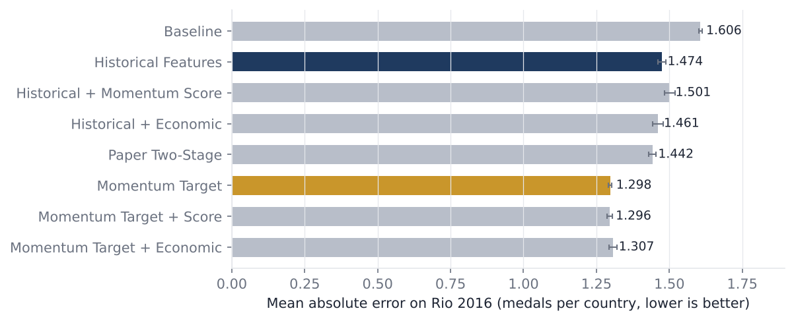

# Temporal Olympic Medal Prediction with Performance Momentum

**UE24CS352A Machine Learning: Mini-Project, Team 53**

| Member | SRN |
| --- | --- |
| Ryona Aditree Ghosh | PES1UG24AM233 |
| Rishit V N S | PES1UG24AM225 |

We forecast how many medals each country will win at a Summer Olympics using **only
information from earlier Games**. Following the reference paper, we also use World Bank indicators and re-run its model families.
Our novelty is **Performance Momentum**: instead of
predicting the medal count directly, the model learns each country's *change* in medals
since its last Games and adds it back to the previous count.

<p align="center"></p>

## Results at a glance

Rio 2016 held-out test, trained on 1964–2012. All eight models share one Random Forest, and the scores are averaged over 5 seeds.
"Economic" means the reference paper's World Bank indicators, taken from the year before the Games.

| Model | Target | MAE ↓ | RMSE ↓ | R² ↑ | Top-10 MAE ↓ | Backtest MAE (1996–2016) ↓ |
| --- | --- | ---: | ---: | ---: | ---: | ---: |
| Baseline (previous medals + golds) | count | 1.606 | 3.85 | 0.913 | 12.26 | 1.629 |
| Historical Features | count | 1.474 | 3.76 | 0.916 | 11.91 | 1.599 |
| Historical + Momentum Score | count | 1.501 | 3.81 | 0.914 | 12.26 | 1.618 |
| Historical + Economic | count | 1.461 | 3.68 | 0.920 | 11.07 | 1.634 |
| Paper Two-Stage (history + economic) | count | 1.442 | 3.75 | 0.917 | 11.34 | 1.557 |
| **Momentum Target (proposed)** | momentum | **1.298** | **3.37** | **0.933** | 10.14 | **1.374** |
| Momentum Target + Score | momentum | 1.296 | 3.39 | 0.932 | 10.16 | 1.389 |
| Momentum Target + Economic | momentum | 1.307 | 3.38 | 0.932 | **9.83** | 1.387 |

* **19.2% lower MAE** than the baseline and **11.9% lower** than the same features predicting the count.
* Statistically supported: the paired bootstrap 95% CI for the MAE drop on Rio 2016 is **0.02 to 0.34 medals per country**, and 99% of resamples favour our model.
* A momentum-target model has the **lowest error in all 6 backtest Games** (1996–2016).
* **The paper's model families, re-run** (history + World Bank features, Rio 2016 MAE, count → momentum):
  Linear 2.22 → 1.38, Ridge 2.20 → 1.35, Lasso 2.21 → 1.31, Random Forest 1.48 → 1.31. Poisson is count-only (1.66).
  The paper's best pairing (Naive Bayes classifier + Ridge) improves from 2.12 to 1.34.
  SVR is the exception (1.32 → 1.58). The medal / no-medal classifiers reach 86–89% on 2012, which matches the paper's 85.5–89.1%.
* **Honest negatives:** the momentum *score* as a feature does not help, and World Bank data barely changes the 2016 error.
  On the real **Tokyo 2020** Games (forecast from data up to 2016) the World Bank models do best
  (Paper Two-Stage MAE 1.506), while Momentum Target is mid-pack (1.557).

Every number is regenerated by the pipeline into `results/`.

## Quick start

```bash
git clone https://github.com/ryonahh/ML_MiniProject_53.git
cd ML_MiniProject_53
python -m venv .venv && source .venv/bin/activate    # Windows: .venv\Scripts\activate
pip install -r requirements.txt

python scripts/run_pipeline.py --quick   # about 30 s: 1 seed, 100 trees, writes to results/quick/
python scripts/run_pipeline.py           # about 6 min: full run, 5 seeds, 300 trees
python -m pytest -q                      # 19 tests
```

The raw Kaggle CSVs are downloaded automatically on the first run (see `data/README.md`).
Then open:

* **Website:** `docs/index.html` in any browser. It works offline, with the fonts and data bundled. It includes a **live predictor**: our Momentum Target forest (100 trees, trained on 1964–2016), exported to JavaScript by `scripts/export_predictor.py`. It runs in the browser and matches scikit-learn's predictions exactly.
* **Notebook:** `notebooks/Olympic_Medal_Prediction.ipynb` (`jupyter notebook notebooks/`).
* **Report and slides:** `deliverables/`.

## Method

1. **Clean.** Summer Games only. Team medals are counted once per event, as in the official tables. NOC codes are mapped to countries, so FRG/GDR become Germany and URS/EUN become Russia.
2. **Aggregate.** One row per Country × Games: athletes, sports, events, gold/silver/bronze and total.
3. **Temporal features.** These come only from earlier appearances (`groupby().shift()`): previous medals and golds, previous athletes, sports and events, medal and athlete growth (log differences), a 3-Games rolling average, and medal efficiency.
4. **World Bank features.** These are the paper's indicators: log GDP, log GDP per capita, GDP growth, log population, population growth, log land area, and shares of world GDP and population. Each comes from the year before the Games (`data/external/world_bank_indicators.csv`, built by `scripts/prepare_world_bank.py`).
5. **Performance Momentum.**
   * *Score:* the mean of the z-scored medal growth, athlete growth and efficiency. It is a sklearn transformer fitted on training rows only.
   * *Target (proposed):* the forest learns `log(1+medals_t) − log(1+medals_{t−1})`, and the forecast is `(1+medals_{t−1})·e^pred − 1`.
6. **Evaluation.** One Random Forest setting for all eight models is chosen on the 2012 validation Games. We then test on 2016 (5 seeds), run a rolling-origin backtest on 1996–2016, run a paired bootstrap, and forecast Tokyo 2020.
7. **The paper's model families.** Linear, Ridge, Lasso, Poisson, SVR and Random Forest regressors, each with both targets, the paper's best two-stage pairing (Naive Bayes + Ridge), and the Logistic, SVM, Naive Bayes, MLP and Random Forest medal / no-medal classifiers. Each is tuned on 2012 and tested on 2016 (`model_zoo.py`).

## Repository layout

```
├── src/olympic_momentum/
│   ├── config.py        paths, feature sets, model specs, splits
│   ├── data.py          download, clean, Country × Year aggregation
│   ├── economic.py      World Bank indicators joined from the year before each Games
│   ├── features.py      leakage-free features + PerformanceMomentum transformer
│   ├── models.py        MedalForecaster (momentum target), two-stage model, metrics
│   ├── experiment.py    tuning, held-out test, backtest, bootstrap, forecast
│   ├── model_zoo.py     the paper's regressors and classifiers, count vs momentum
│   ├── reporting.py     CSV/JSON results and figures
│   ├── site_data.py     exports docs/assets/data.js for the website
│   └── export_model.py  exports the forest to docs/assets/model.js (live predictor)
├── scripts/
│   ├── run_pipeline.py          runs everything
│   ├── prepare_world_bank.py    extracts the six WDI series from the bulk download
│   └── export_predictor.py      re-exports the website's live predictor
├── tests/test_pipeline.py
├── notebooks/Olympic_Medal_Prediction.ipynb
├── data/                raw (downloaded), processed, external (World Bank, Tokyo 2020 actuals)
├── results/             metrics.json, *.csv, figures/
├── docs/                project website (GitHub Pages ready)
└── deliverables/        report (PDF) and slides (PPTX)
```

## Reference

B. Dobkowski, *2020 Summer Olympics Predictions Using Machine Learning*, Stanford University.
Dataset: R. Griffin, *120 years of Olympic history: athletes and results*, Kaggle.
World Bank, *World Development Indicators* (bulk CSV download).
